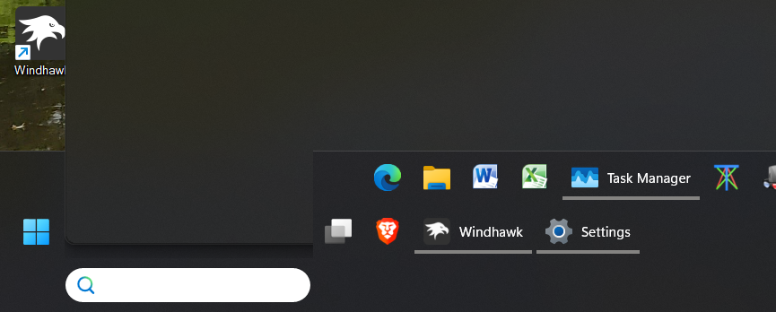

# Draggable, All-in-One Multirow Taskbar & Systray for Windows 11

Drag the top edge of the Windows 11 taskbar to resize it into multiple rows.
Taskbar buttons and ordinary notification-area icons stay in sync with the
chosen row count, giving Windows 11 a more Windows 10-style multirow taskbar
without running several separate taskbar mods at once.


## Features

- Drag the top edge of the taskbar to switch between one or more rows.
- Span taskbar buttons across multiple rows.
- Wrap ordinary notification-area icons across matching rows.
- Keep Wi-Fi, sound, battery, clock, overflow, and the native one-row fallback
  behavior separate from the ordinary tray-icon grid.
- Use conservative first-install defaults: one row, native-looking taskbar
  height, and native single-row tray behavior until you resize.
- Include Windows 10-style running indicators and compact Start/Search/Task View
  hover behavior as part of the integrated setup.
- Use hardcoded integrated defaults; resize by dragging the taskbar edge rather
  than changing Windhawk settings.
- Leave the auto-hide reveal strip accessible while the taskbar is hidden.
  Windows remains responsible for the auto-hide preference.

## Manual install

This mod is not currently listed in the official Windhawk catalog. Install it as
a local/custom Windhawk mod from the single source file in this repository.

1. Install Windhawk from <https://windhawk.net/>.
2. Open the raw mod source:
   <https://raw.githubusercontent.com/andkondev/draggable-multirow-taskbar-systray-windows-11/main/mods/draggable-multirow-taskbar-systray-windows-11.wh.cpp>
3. In Windhawk, create a new local/custom mod from source.
4. Paste the contents of the raw `.wh.cpp` file into the Windhawk editor.
5. Compile the mod in Windhawk.
6. Exit editing mode and enable the local mod.

The mod starts conservatively at one taskbar row. After enabling it, drag the
top edge of the taskbar upward to add rows, or downward to return to fewer rows.

The source file to install is:

```text
mods/draggable-multirow-taskbar-systray-windows-11.wh.cpp
```

The Windhawk mod id is `draggable-multirow-taskbar-systray-windows-11`.

To update an existing local install, replace the source in Windhawk with the
latest raw file contents and compile again. If the taskbar does not refresh
cleanly after enabling, disabling, or updating, restart Explorer or sign out and
back in.

## Notes and limitations

- The full Windows Search box can make the Search flyout overlap the taskbar on
  multirow layouts. The Search icon and Search icon-and-label modes behave
  better.
- Hidden tray icons are still controlled by Windows in Settings >
  Personalization > Taskbar > Other system tray icons.
- Disabling and re-enabling the mod can briefly flash while Explorer and
  Windhawk reload taskbar components.



## No warranty

This mod is provided as-is, without warranty of any kind. It modifies Windows
Explorer and taskbar behavior through Windhawk hooks, so use it at your own
risk. Windows updates, Windhawk updates, Explorer changes, or taskbar-related
system changes may break behavior.

## Credits and license

This project is licensed under GPL-3.0.

This mod is built on m417z's Windhawk taskbar work:

- Taskbar height and icon size
- Multirow taskbar for Windows 11
- Taskbar tray icon spacing and grid
- Windows 11 Taskbar Styler

Thank you to m417z and the Windhawk project for the original mods and the
platform that makes this kind of taskbar customization possible.

See [THIRD_PARTY_NOTICES.md](THIRD_PARTY_NOTICES.md) for attribution details.
